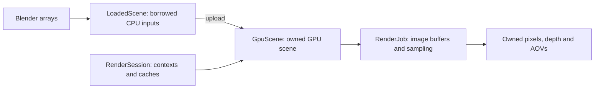

# Module boundaries and resource lifetimes

The crate boundaries follow the execution layers: `optix-sys` supplies FFI,
`optix` wraps the API, `vibrt-nodes` evaluates shared CPU/CUDA nodes, and `vibrt`
loads and renders scenes. The Blender addon owns Blender data access and export.

## Native rendering



- `render/session.rs` owns CUDA/OptiX contexts, one cached compiled shader
  variant, and a bounded CPU query-tree cache. It also manages acceleration
  builds and denoiser creation. Sessions are confined to their creating thread.
- `render/gpu_scene.rs` owns materials, textures, mesh buffers, acceleration
  structures and the shader binding table. Its lifetime borrows the session,
  not `LoadedScene` or Python arrays. Upload completes before those inputs may
  be released. Acceleration-build scratch is released after the build completes.
- `render/job.rs` borrows an uploaded scene and owns each render's output and
  accumulation buffers. Sample count, resolution, depth and denoising overrides
  can change between jobs. Callback errors, cancellation and Rust unwinding
  drain queued sampling work before job buffers are released.
- `material.rs` optimizes CPU graphs and derives `ShaderRequirements` without
  depending on CUDA compilation. `device/shaders.rs` creates OptiX programs;
  `device/pipeline.rs` assembles and caches PTX. The former `pipeline` and
  `shader_compile` public module paths remain available as re-exports.
- `render/lighting.rs` builds environment distributions and embeds the GGX LUT.

Rust callers can upload once and run several jobs:

```rust,ignore
use vibrt_native::render::{GpuScene, RenderJob, RenderOptions, RenderSession};

let session = RenderSession::new()?;
let gpu_scene = GpuScene::upload(&session, &loaded_scene, &mut progress)?;
drop(loaded_scene);
for spp in [8, 32] {
    let options = RenderOptions { spp: Some(spp), ..Default::default() };
    let output = RenderJob::new(&gpu_scene, options).render(&mut progress)?;
    // Consume output.pixels, output.depth and output.aovs.
}
```

`render_to_pixels` and Python `vibrt_native.render` retain their existing
one-call interface. They reuse one idle session per thread after successful
renders. Reentrant callbacks acquire a separate session; errors discard the
idle-cache candidate. The shader cache key covers every compilation requirement,
and live scenes retain their shader variant when another variant replaces it.

The Blender path still exports and uploads a new scene for each render. Geometry,
material or camera edits require a new `GpuScene`; incremental scene updates and
automatic persistent-scene invalidation are separate work. This refactor reduces
repeated pipeline setup and establishes ownership for reuse, without changing the
path-tracing algorithm or its per-light and shader-VM costs.

## Blender export

`ExportContext` owns material identity, warning deduplication, texture conversion
caches, group traversal state, timing statistics and prepared sky maps for one
export. `material_export` and `shader_graph` both use `texture_export` for image
services; the graph compiler no longer imports material traversal. Logging sinks
use `ContextVar` so nested exports and separate threads keep their own callbacks.

Create a context for each export. Pass the same one through sky preparation and
scene export so the world consumes the correct environment maps:

```python
from vibrt_blender import exporter, sky_bake
from vibrt_blender.export_context import ExportContext

context = ExportContext()
with sky_bake.prepare_scene_async(scene, context=context) as finish_sky:
    description, blobs, textures = exporter.export_scene_to_memory(
        depsgraph, serialize=False, context=context, prepare_world=finish_sky,
    )
```

For blocking scripts, `context = sky_bake.prepare_scene(scene)` returns its
context. Scene export without an explicit context creates a fresh one. Legacy
diagnostic helpers that prepare or inspect sky maps now require `context=`;
there is no module-global sky cache. Export statistics and image conversion caches
reset when exporting a scene. Sky maps remain in that context until it is discarded
or explicitly cleared, so callers reusing a context after world edits must prepare
the sky again.

## CUDA source and validation

`devicecode.cu` includes the ordered modules in `device/`: math, volume, surface,
environment, visibility, material evaluation, lighting, geometry, scene queries,
OptiX programs and the integrator. NVRTC source assembly expands these headers
into one translation unit. Keep shared ABI structs in `devicecode.h` synchronized
with `gpu_types.rs`. Splitting the source itself does not change GPU execution.

CPU checks include `cargo test -p vibrt-nodes`, `cargo test -p vibrt --lib`,
`scripts/check_struct_layouts.py` and the addon's `test_*.py` suites.
`test_export_context.py` tests state isolation without Blender. GPU ownership
tests are opt-in:

```bash
cargo test --release -p vibrt --lib -- --ignored --test-threads=1
cargo test --release -p vibrt --test render_reuse -- --ignored --test-threads=1
```

Run Blender integration suites with `blender -b --factory-startup
--python-exit-code 1 --python scripts/<suite>.py`: `test_export_context`,
`test_native_scene`, `test_node_exports`, `test_displacement`, `test_shader_graphs`,
`test_sky_bake`, `test_native_sky`, `test_shader_precompile` and
`test_progressive_render`. The last suite can save a pre-change baseline with
`-- --save-baseline` and subsequently compare color, depth and denoised output
exactly.
